# Little by Little — A Personal Growth & Well-being App for Young People 🌱

[](https://developer.android.com/)
[](https://www.oracle.com/java/)
[](https://firebase.google.com/)
[](https://developer.android.com/training/data-storage/room)
[](LICENSE)

> *"Little by little, a little becomes a lot."* — A compassionate, evidence-based digital companion built specifically for young people, teenagers, and students to overcome social communication anxiety, overwhelm, and comparison burnout.

---

## 📖 Table of Contents
- [About the Project](#-about-the-project)
- [Architecture & Tech Stack](#-architecture--tech-stack)
- [Comprehensive Lab Curriculum Coverage](#-comprehensive-lab-curriculum-coverage)
  - [Lab 8: Getting Started with Android Studio & Fundamentals](#lab-8-fundamentals--architecture)
  - [Lab 9: UI, Custom Views, ListView & RecyclerView](#lab-9-ui-recyclerview-custom-views--ux)
  - [Lab 10: Android Components (Services, Receivers, Providers)](#lab-10-android-components)
  - [Lab 11: Networking & Data Storage](#lab-11-networking--data-storage)
- [Feature Walkthrough & Screenshots](#-feature-walkthrough--screenshots)
- [API & Database Integrations](#-api--database-integrations)
  - [External REST APIs & XML Parsing](#external-rest-apis--xml-parsing)
  - [Local SQLite (Room) Architecture](#local-sqlite-room-architecture)
  - [Firebase Cloud Ecosystem](#firebase-cloud-ecosystem)
- [Installation & Setup](#-installation--setup)
- [Project Report](#-project-report)

---

## 🎯 About the Project

Young people and students today navigate high expectations, academic stress, digital overwhelm, and social anxiety. Traditional productivity apps are often rigid, punitive, or trigger guilt when streaks lapse.

**Little by Little** addresses these challenges through gentle, clinically informed micro-habits:
1. **Daily Emotional Check-ins**: Safe emotional labelling with low cognitive barrier, providing instant inline CBT grounding feedback directly on the card and robust calendar-distinct streak tracking.
2. **Social Skills Gym**: Infinite procedural auto-generating scenario simulations (`PracticeScenarioGenerator`) with instant communication impact feedback to build confidence in real-world dilemmas.
3. **Guided Reflection Journaling**: Positive reframing and emotional debriefing with full CRUD persistence across SQLite Room and Cloud Firestore.
4. **Mindful Calm Session (Foreground Service)**: Focused 5-minute breathing timers running with foreground system notifications and bound IPC countdown.
5. **Support Circle & Content Providers**: Direct contact with a trusted buddy through system contacts (`ContactsContract`) and dialer intents (`ACTION_DIAL`).
6. **Kindred Minds Community (Firestore)**: Real-time uplifting peer support feed with likes and shared micro-wins.
7. **My Growth Analytics (Custom View)**: Compassionate visual feedback on progress through a custom circular arc gauge (`MoodProgressView`).

---

## 🏗 Architecture & Tech Stack

```mermaid
graph TD
    UI[Activities & Fragments<br/>Home, Practice, Journal, Growth, Profile]
    VB[View Binding & Material Design 3]
    UI --> VB

    subgraph Background Services & Broadcasts
        SVC[MindfulCalmService<br/>Started + Bound + Foreground]
        REC[SystemStatusReceiver<br/>Airplane, Battery, Custom Actions]
        NOTIF[NotificationHelper<br/>Notification Channels]
        SVC --> NOTIF
        SVC -. Broadcast .-> REC
    end
    UI <--> SVC

    subgraph Data & Sync Layer
        DB[(Room SQLite DB<br/>CheckIns & Journals)]
        SYNC[FirebaseSyncHelper<br/>Realtime DB & Firestore Sync]
        API[QuoteApiClient & XML Parser<br/>ZenQuotes GET + httpbin POST]
        UI --> DB
        UI --> SYNC
        UI --> API
    end

    subgraph Cloud Ecosystem
        FB_AUTH[Firebase Auth<br/>Email/Password]
        FB_RTDB[Firebase Realtime DB<br/>users/{uid}/checkins]
        FB_STORE[Cloud Firestore<br/>users/{uid}/journals & community_feed]
        FB_STORAGE[Firebase Storage<br/>profile_photos/{uid}]
        SYNC --> FB_RTDB
        SYNC --> FB_STORE
        SYNC --> FB_STORAGE
    end
```

- **Architecture**: Single-Activity navigation container (`MainActivity`) host with modern `Fragment` navigation, backed by multi-activity sub-flows.
- **Language**: Java 11 / Java 8 bytecode compatibility.
- **Gradle**: Android Gradle Plugin 8.0+, AndroidX Jetpack libraries.
- **UI System**: View Binding, Material Design 3, ConstraintLayout, LinearLayout, RelativeLayout, ScrollView.
- **Custom Views**: `MoodProgressView` extending `android.view.View` with custom canvas 2D drawing.

---

## 📚 Comprehensive Lab Curriculum Coverage

### Lab 8: Fundamentals & Architecture
- **Android Studio Project Architecture & Gradle**: Multi-module standard layout, `build.gradle` dependency injection (Firebase, Room, Glide, Material).
- **`AndroidManifest.xml`**: Complete declaration of all 8 Activities, Service with `android:foregroundServiceType="specialUse"`, `SystemStatusReceiver`, notification permissions, internet, and contacts permissions.
- **Activity Lifecycle**: Logging and state handling across `onCreate()`, `onStart()`, `onResume()`, `onPause()`, `onStop()`, and `onDestroy()`.
- **View Binding & Event Handling**: Replaced `findViewById` boilerplate with type-safe View Binding (`FragmentHomeBinding`, `ActivityCommunityFeedBinding`, etc.) and lambda `OnClickListener` implementations.
- **Intents & Multiple Activities**:
  - **Explicit Intents**: Inter-activity data passing with `Intent.putExtra()` (e.g. passing preselected mood from `HomeFragment` to `CheckInActivity`, passing journal ID/content to `EditJournalActivity`).
  - **Implicit Intents**:
    - `Intent.ACTION_DIAL` (`tel:555-0199`) in `TrustedContactActivity`.
    - `Intent.ACTION_SEND` (`text/plain`) in `JournalFragment` for social sharing.
    - `Intent.ACTION_GET_CONTENT` (`image/*`) in `ProfileActivity` for photo picking.
    - `Intent.ACTION_PICK` (`ContactsContract.CommonDataKinds.Phone.CONTENT_URI`) for contact picking.
- **Activity Navigation & Back Stack Clearing**: Controlled back stack navigation with `FLAG_ACTIVITY_NEW_TASK | FLAG_ACTIVITY_CLEAR_TASK` on logout and authentication redirection.

### Lab 9: UI, RecyclerView, Custom Views & UX
- **Layout Managers**:
  - `ConstraintLayout`: Responsive card hierarchies and proportional spacing.
  - `LinearLayout` & `RelativeLayout`: Structured headers, avatars, and horizontal pill button groups.
  - `ScrollView`: Fluid vertically scrollable dashboards across different screen sizes.
- **Custom View Implementation**:
  - [`MoodProgressView.java`](app/src/main/java/com/example/littlebylittle/MoodProgressView.java): Custom Android component extending `View` implementing `onMeasure()` and `onDraw()` with anti-aliased `Paint`, background circular track, dynamic arc rendering, and animated percentage sweep.
- **ListView & Custom Adapter**:
  - [`CheckInHistoryActivity.java`](app/src/main/java/com/example/littlebylittle/CheckInHistoryActivity.java) utilizes `android.widget.ListView` paired with [`CheckInListAdapter.java`](app/src/main/java/com/example/littlebylittle/CheckInListAdapter.java) using the ViewHolder pattern and custom [`item_check_in.xml`](app/src/main/res/layout/item_check_in.xml) layout with dynamic item deletion.
- **RecyclerView & Adapters**:
  - [`JournalHistoryActivity.java`](app/src/main/java/com/example/littlebylittle/JournalHistoryActivity.java): `RecyclerView` + [`JournalAdapter.java`](app/src/main/java/com/example/littlebylittle/JournalAdapter.java) with edit and delete callbacks.
  - [`CommunityFeedActivity.java`](app/src/main/java/com/example/littlebylittle/CommunityFeedActivity.java): `RecyclerView` + [`CommunityAdapter.java`](app/src/main/java/com/example/littlebylittle/CommunityAdapter.java) with real-time support counter toggles.
- **Procedural Scenario Generation & Dynamic UI**:
  - [`PracticeScenarioGenerator.java`](app/src/main/java/com/example/littlebylittle/PracticeScenarioGenerator.java) algorithmically synthesizes dilemma scenarios dynamically rendering choice options and instant psychological feedback in [`PracticeFragment.java`](app/src/main/java/com/example/littlebylittle/PracticeFragment.java) with smooth programmatic auto-scroll.
- **UX Principles**: Calming color palette (lavender, soft purple, sage green), botanical watercolor artwork on Welcome screen, visible affordances, and zero-state illustrations.

### Lab 10: Android Components
- **Android Services**:
  - [`MindfulCalmService.java`](app/src/main/java/com/example/littlebylittle/MindfulCalmService.java):
    - **Started Service**: Triggered via `ACTION_START` / `ACTION_STOP`.
    - **Bound Service**: Returns `LocalBinder` to allow client activities (`HomeFragment`) to poll countdown status and interact with active session.
    - **Foreground Service**: Promoted using `startForeground()` displaying an ongoing non-dismissible notification.
- **Notifications**:
  - [`NotificationHelper.java`](app/src/main/java/com/example/littlebylittle/NotificationHelper.java) configures Notification Channels (`channel_mindful_calm`, `channel_daily_reminders`) compliant with Android 8.0+ (API 26+) and runtime `POST_NOTIFICATIONS` permission (API 33+).
- **BroadcastReceiver**:
  - [`SystemStatusReceiver.java`](app/src/main/java/com/example/littlebylittle/SystemStatusReceiver.java):
    - **System Broadcasts**: Listens for `ACTION_AIRPLANE_MODE_CHANGED`, `ACTION_BATTERY_LOW`, and `ACTION_BATTERY_OKAY`.
    - **Custom Broadcast**: Listens for `com.example.littlebylittle.ACTION_GROWTH_DATA_UPDATED`.
- **Content Providers**:
  - [`TrustedContactActivity.java`](app/src/main/java/com/example/littlebylittle/TrustedContactActivity.java) reads system contacts using `ContentResolver.query()` targeting `ContactsContract.CommonDataKinds.Phone.CONTENT_URI` with runtime `READ_CONTACTS` permission.

### Lab 11: Networking & Data Storage
- **Android Networking**:
  - **HTTP GET & JSON**: [`QuoteApiClient.java`](app/src/main/java/com/example/littlebylittle/QuoteApiClient.java) performs background `HttpURLConnection` GET to `https://zenquotes.io/api/today` and parses JSON quote and author payloads.
  - **HTTP POST & JSON**: Performs `HttpURLConnection` POST to `https://httpbin.org/post` transmitting reflection metadata, verified with HTTP 200 responses.
- **XML Parsing**:
  - [`MindfulnessXmlParser.java`](app/src/main/java/com/example/littlebylittle/MindfulnessXmlParser.java) parses structured mindfulness prompts from `res/xml/mindfulness_prompts.xml` using `XmlPullParser`.
- **Database Manipulation (Room SQLite)**:
  - SQLite abstraction via Jetpack Room: [`AppDatabase.java`](app/src/main/java/com/example/littlebylittle/AppDatabase.java), [`CheckInDao.java`](app/src/main/java/com/example/littlebylittle/CheckInDao.java), [`JournalDao.java`](app/src/main/java/com/example/littlebylittle/JournalDao.java).
  - Background asynchronous execution via `Executors.newSingleThreadExecutor()` preventing ANR errors.
  - Implements `@Update void updateCheckIn(CheckIn checkIn)` and distinct calendar date streak aggregation (`calculateConsecutiveDayStreak`), preventing multiple mood taps on the same day from creating duplicate records or inflating streak metrics.
- **Firebase Suite**:
  - **Firebase Authentication**: Email/Password and one-tap Google Sign-In (`play-services-auth:20.7.0`, `GoogleAuthHelper.java`), user registration, login, profile updates, and secure session management.
  - **Firebase Realtime Database**: Synchronizes emotional check-ins partitioned by UID (`users/{uid}/checkins`).
  - **Cloud Firestore**: Real-time snapshot listeners for `community_feed` and private `users/{uid}/journals`.
  - **Firebase Storage**: Avatar picture uploads with download URL generation.
  - **Security Rules**: Production-grade rules enforced in `firestore.rules`, `database.rules.json`, and `storage.rules`.

---

## 📸 Feature Walkthrough & Screenshots

| Welcome & Onboarding (Google Auth) | Login Screen (Google Sign-In) | Registration Screen |
|:---:|:---:|:---:|
| 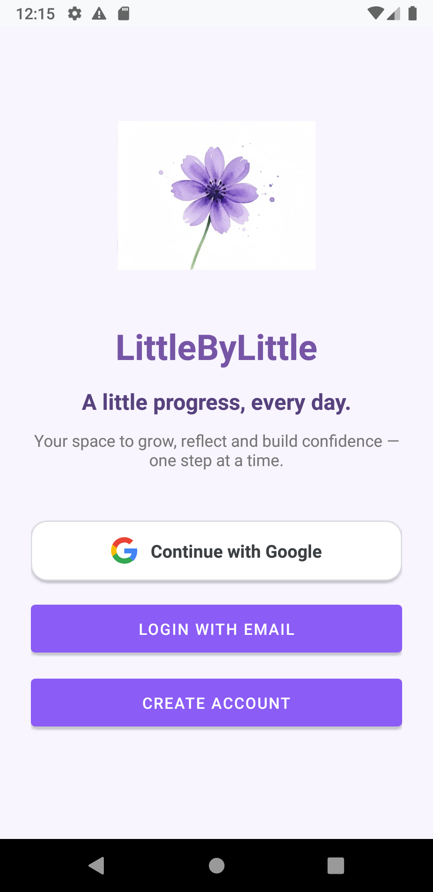 | 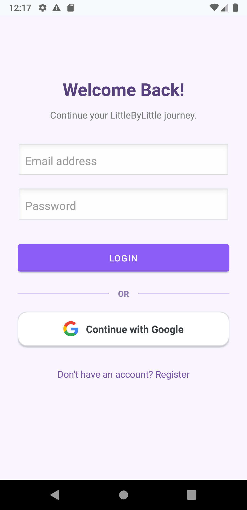 | 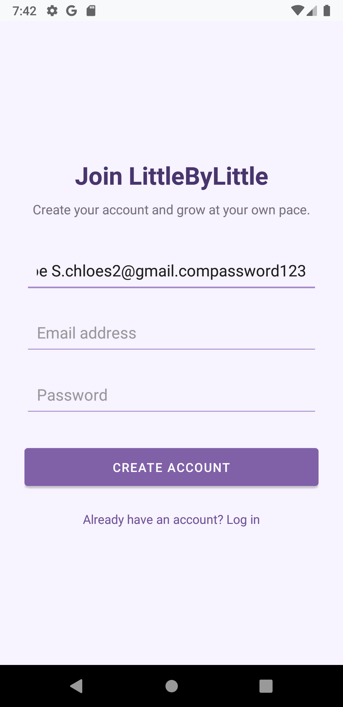 |
| *Gentle entry portal with lavender flower & Google Sign-In* | *Email/password & Google Sign-In options* | *New member account creation* |

| Home Dashboard (Calendar Streak) | Inline CBT Grounding Check-in | Mindful Calm Session (Foreground) |
|:---:|:---:|:---:|
| 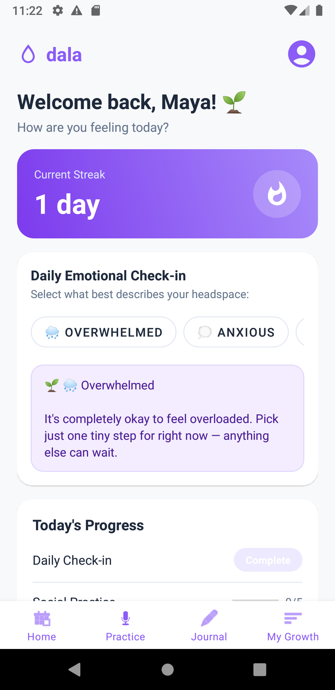 |  | 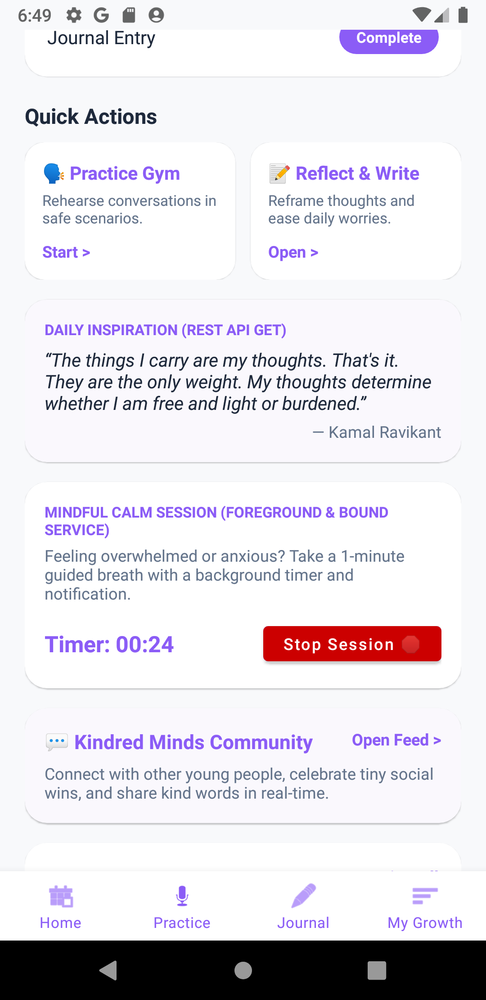 |
| *Accurate calendar streak & ZenQuotes API* | *Instant grounding advice on card click* | *Foreground service & bound timer* |

| Social Skills Gym (Auto-Generated) | Actionable Social Feedback | Kindred Minds Community (Firestore) |
|:---:|:---:|:---:|
| 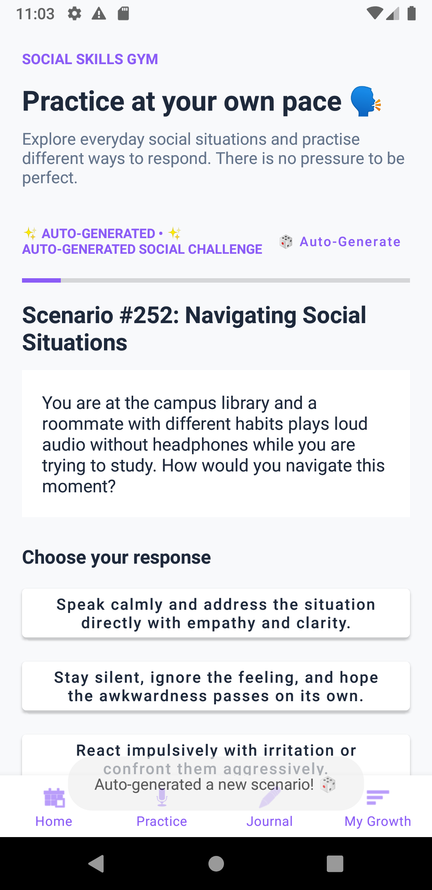 | 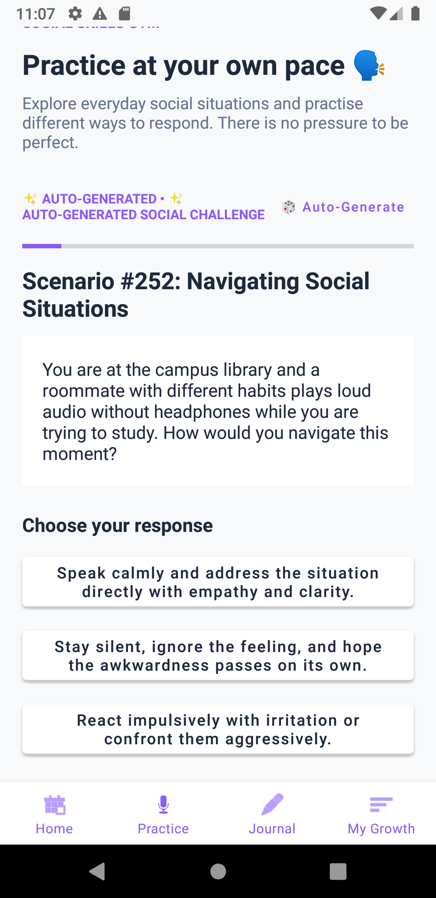 | 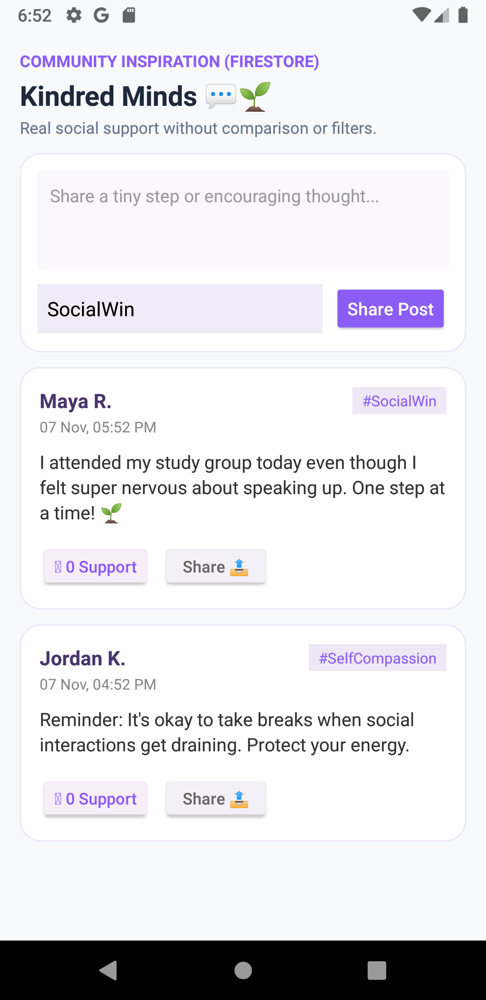 |
| *Infinite procedural scenario generator* | *Empathetic psychological guidance* | *Real-time peer support stream* |

| Daily Check-in Form | Check-in History (ListView) | Dynamic Item Deletion |
|:---:|:---:|:---:|
| 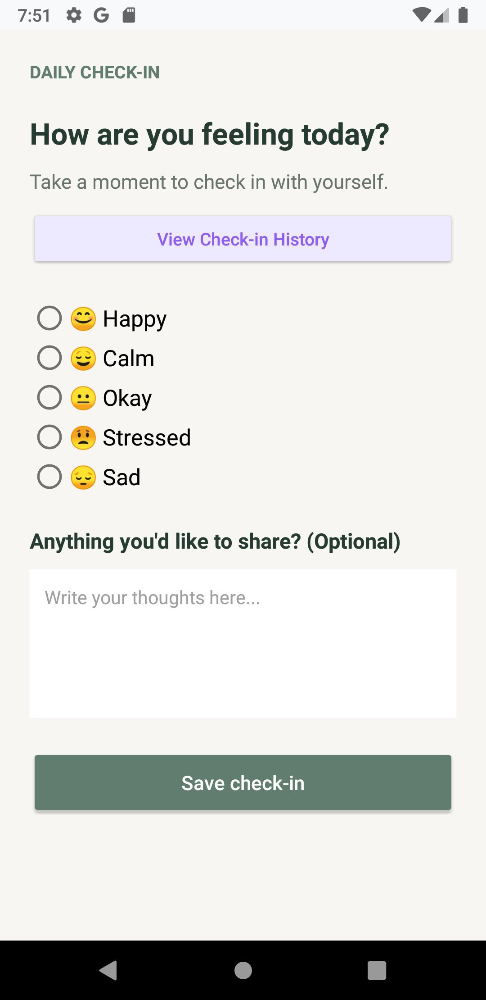 | 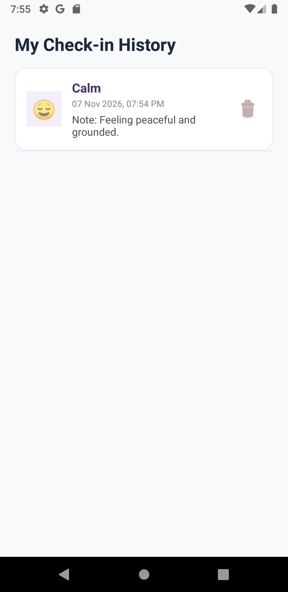 | 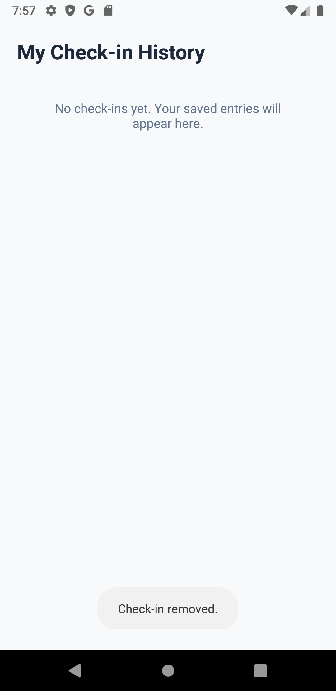 |
| *Mood selection & notes* | *Custom CheckInListAdapter* | *Room & Realtime DB delete* |

| Guided Journaling | Journal History (RecyclerView) | Edit Journal Reflection |
|:---:|:---:|:---:|
| 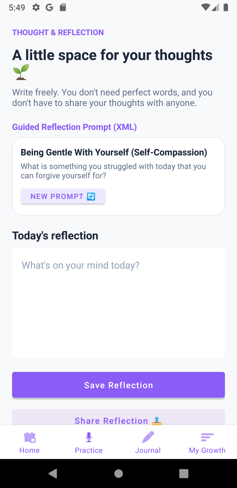 | 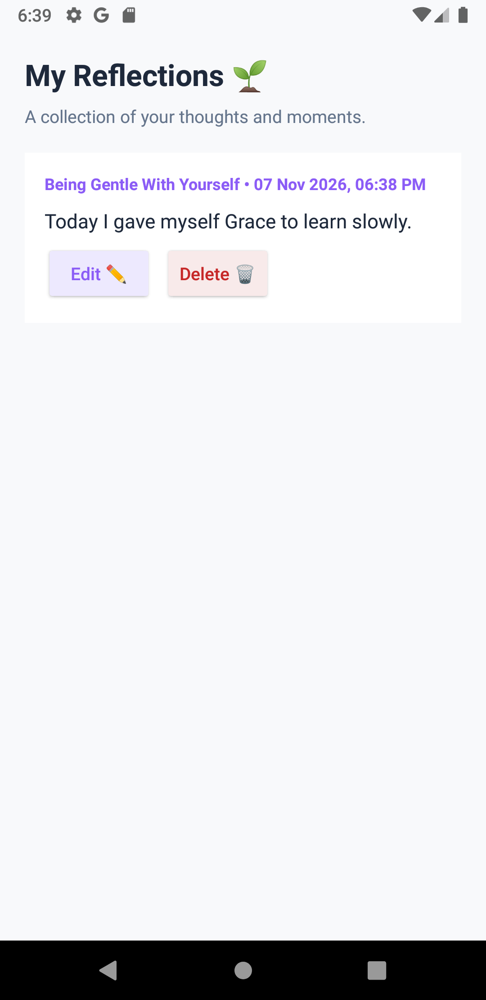 | 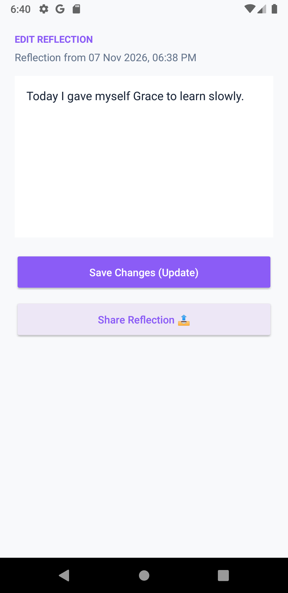 |
| *Positive reflection prompt* | *RecyclerView + JournalAdapter* | *Intent extras & update CRUD* |

| My Growth (Custom View) | Profile & Account | Support Circle (Buddy) |
|:---:|:---:|:---:|
| 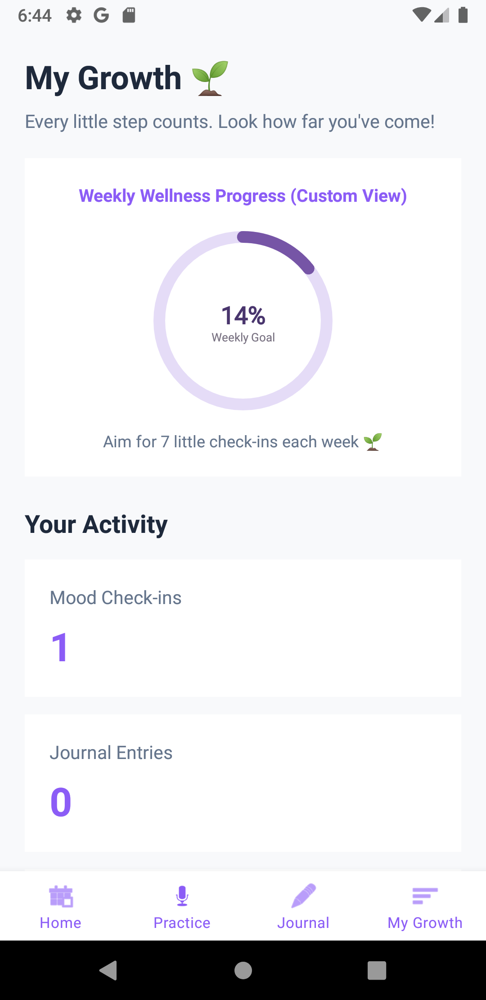 | 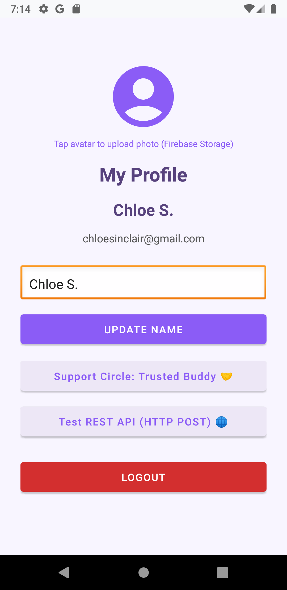 | 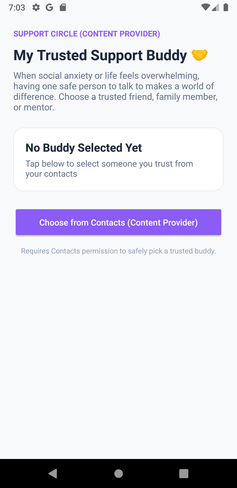 |
| *MoodProgressView circular gauge* | *Profile name edit & avatar sync* | *Trusted contact configuration* |

| Contacts Content Provider | Direct Dialer Intent |
|:---:|:---:|
| 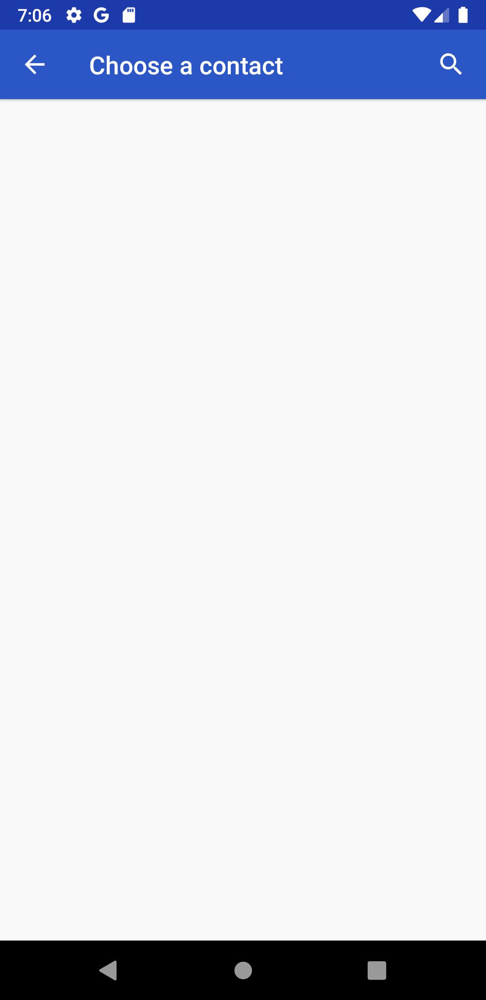 | 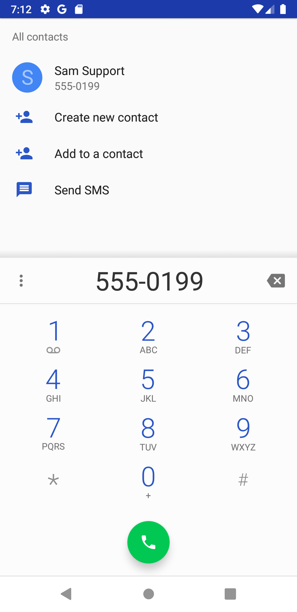 |
| *ContactsContract query* | *Implicit Intent (ACTION_DIAL)* |

---

## 🔌 API & Database Integrations

### External REST APIs & XML Parsing
- **ZenQuotes API (HTTP GET)**:
  - Endpoint: `https://zenquotes.io/api/today`
  - Response:
    ```json
    [
      {
        "q": "The journey of a thousand miles begins with one step.",
        "a": "Lao Tzu",
        "h": "<blockquote>...</blockquote>"
      }
    ]
    ```
- **httpbin Reflection Endpoint (HTTP POST)**:
  - Endpoint: `https://httpbin.org/post`
  - Payload:
    ```json
    {
      "source": "LittleByLittle_Android",
      "action": "TEST_REFLECTION_SYNC",
      "timestamp": 1794142800000,
      "reflection": "Today I took one small step forward."
    }
    ```
  - Response: Verified HTTP 200 OK.
- **Local XML Parsing (`XmlPullParser`)**:
  - Source: `res/xml/mindfulness_prompts.xml`
  - Parses category, text, and duration tags into strong Java model objects.

### Local SQLite (Room) Architecture
```sql
-- CheckIns Table
CREATE TABLE check_ins (
    id INTEGER PRIMARY KEY AUTOINCREMENT NOT NULL,
    userId TEXT,
    mood TEXT,
    note TEXT,
    timestamp INTEGER NOT NULL
);

-- Journals Table
CREATE TABLE journal_entries (
    id INTEGER PRIMARY KEY AUTOINCREMENT NOT NULL,
    userId TEXT,
    content TEXT,
    timestamp INTEGER NOT NULL
);
```

### Firebase Cloud Ecosystem
- **Authentication**: Email/Password provider with persistent local auth token and profile display updates.
- **Realtime Database**: Real-time two-way synchronization under `users/{userId}/checkins`.
- **Cloud Firestore**:
  - `users/{userId}/journals/{journalId}`: Private reflection repository with owner-only access.
  - `community_feed/{postId}`: Public stream with atomic `likeCount` increments and `likedBy` array checks.
- **Firebase Storage**: `profile_photos/{userId}/avatar.jpg` for user avatar image persistence.
- **Security Rules**: All 4 rule configuration files (`firestore.rules`, `database.rules.json`, `storage.rules`, `firebase.json`) included in project root.

---

## 💻 Installation & Setup

### Prerequisites
1. Android Studio Flamingo or newer (Giraffe/Hedgehog/Iguana recommended).
2. JDK 11 or higher (bundled with Android Studio).
3. Android SDK API 33 (Tiramisu) platform and build tools.
4. Android Emulator or physical device running Android 8.0 (API 26) or higher.

### Steps
1. **Clone the repository**:
   ```bash
   git clone https://github.com/Belllii/Little-by-Little-A-Personal-Growth-and-Well-being-App-for-Young-People.git
   cd Little-by-Little-A-Personal-Growth-and-Well-being-App-for-Young-People
   ```
2. **Open in Android Studio**:
   - Select **Open an Existing Project** and browse to the repository folder.
   - Allow Gradle sync to complete.
3. **Build the project**:
   ```bash
   ./gradlew assembleDebug
   ```
4. **Run on Emulator / Device**:
   - Click **Run 'app'** (Shift + F10) in Android Studio, or install via ADB:
   ```bash
   adb install -r app/build/outputs/apk/debug/app-debug.apk
   adb shell am start -n com.example.littlebylittle/.MainActivity
   ```

---

## 📄 Project Report

A formal, typed project report document complying with all course requirements is provided:
- **Word Document (.docx)**: [`Project_Report_Little_by_Little.docx`](Project_Report_Little_by_Little.docx)
- **Included Sections**:
  - Executive Overview & Problem Definition
  - Detailed Feature Walkthrough accompanied by high-resolution screenshots
  - API & Database Integration evidence (ZenQuotes, httpbin, XML, Room SQLite, Firebase suite)
  - Complete Lab 8 - Lab 11 syllabus alignment matrix with source code citations
  - Live Testing & Demonstration verification logs

---

## 👩‍💻 Author & Acknowledgements
- Developed by **Belllii** (`efatbelly@gmail.com`)
- Built for **CSE2200 / Mobile Application Development Laboratory**
- Designed with empathy and care for youth mental health and emotional well-being.
